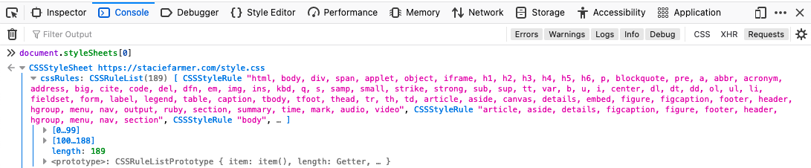

Same-origin policy is the backbone of web security, or so I hear. 

So what is it? How does it work? How does it protect us and where does it fail?

<!--more-->



---

## What's an Origin?
If we want to learn what *Same-Origin Policy* is, we need to clarify what exactly an *origin* is.

An origin is the:
- **protocol** *(e.g. http, https, ftp, etc)*
- **host** *(e.g. staciefarmer.com, blog.staciefarmer.com, etc)*
	- We ignore paths *(e.g. /tutorial)* when looking at the host. It's only the domain + any subdomains.
- **port number** *(e.g. 80, 443, 21, etc)*

The **protocol, host, and port number** combined make up the origin.

For example, the URL `https://staciefarmer.com/tutorials` would have the origin of: `https://staciefarmer.com` with an implied port of 443 *(for HTTPS)*.

### Different subdomains are different origins
Subdomains can make one origin different from another. 

For example, the URL `https://staciefarmer.com` has a different origin than the URL `https://blog.staciefarmer.com`. In this example, the *host* is different - `staciefarmer.com` vs `blog.staciefarmer.com`.

[CodeDocs has a helpful table](https://codedocs.org/what-is/same-origin-policy#Origin_determination_rules){:target="_blank"} to visualize what makes an origin different from another.

***Remember:* Origin = Protocol + Host + Port #**


## What is Same-Origin Policy (SOP)?
The Same-Origin Policy means anytime Javascript in your webpage tries to read/fetch a cross-origin *(i.e. 3rd party or external)* resource, the browser will not let Javascript read the HTTP response.

Same-Origin Policy (SOP) is enforced *by the browser*. This is useful to remember because SOP isn't enforced when using a client that's not a browser. It's not a security concern because Javascript runs in the browser and 99% of users use a browser, but it's useful to understand.

Let's see some examples of SOP in action.

### SOP example with CSS

Let's say you're a developer and you have a local CSS file included in your webpage:
```
<head>
	<link href="styles.css" rel="stylesheet">
</head>
```

You can use Javascript to read the CSS rules. To test this, you can view your webpage in the browser, open up the Console, and type:
```
document.styleSheets[0]
```

Once you press `Enter`, you'll see a CSSStyle object that you can view. If you open that up, the first list you'll see is the CSS rules for that stylesheet. You can look through them all you want. And this means any Javascript running on your webpage can access these CSS rules.



However, if you include some 3rd party/cross-origin CSS in your webpage like so:

```
<head>
	<link href="https://otherwebsite.com/styles.css" rel="stylesheet">
</head>
```

And you try the same thing to use Javascript to read the CSS rules, you won't be able to. Instead, you'll be greeted with an error like:
```
rules: DOMException: CSSStyleSheet.rules getter: Not allowed to access cross-origin stylesheet
```

This means Javascript running on your webpage cannot access those CSS rules.

But the *styles* from this external stylesheet will be applied to the webpage. Otherwise, we couldn't have such beautiful websites styled with external CSS like Bootstrap.

What exactly is happening here?

1. The HTTP request is sent to `https://otherwebsite.com/styles.css` to fetch the styles for your webpage
2. The HTTP response returns and your *browser* uses that data to style your webpage
3. Your browser prevents Javascript from accessing that HTTP response so it can't read the cross-origin style rules

This is the crux of SOP. We can make a `GET` or `POST` request to cross-origin resources, but Javascript isn't allowed to read the HTTP response.

### SOP example with misconfigured external API

What if we want to read an external Application Programming Interface (API), but they haven't implemented Cross-Origin Resource Sharing (CORS) yet?

This API is supposed to let us gather weather data and display it on our website, which we think will be a nice feature for our webpage.

We read their documentation and write some Javascript to fetch the API data.
```
fetch('https://weathersite.com/getWeatherData')
```

We've decided not to write out all the code yet, until we get the first part working. So we run this code and what do we see?
```
Cross-Origin Request Blocked: The Same Origin Policy disallows reading the remote resource at https://weathersite.com/getWeatherData. (Reason: CORS header 'Access-Control-Allow-Origin' is missing).
```

Without CORS, SOP prevents Javascript from fetching cross-origin *(i.e. 3rd party or external)* resources. That's why we see the error above.

We'll discuss CORS and how it works in another article.

### SOP summary
So far, we've learned that:
- SOP allows resources to be a part of our HTML page 
	- *(e.g. we can embed images and other media, use external styles, include 3rd party scripts, etc)*
- SOP prevents Javascript from reading *(i.e. seeing the HTTP response)* of cross-origin/3rd party resources

---

## How does SOP protect us?
How does preventing Javascript from reading the cross-origin HTTP response help us, as users? A lot, actually.

As a user, let's say SOP doesn't exist and we've logged into Twitter. In another tab, we've unknowingly visited a malicious website.

This malicious website has Javascript on it that makes an HTTP request to Twitter. Because we're logged into Twitter, the browser helpfully attaches our authentication cookie to the HTTP request. With no SOP, the malicious website receives the HTTP response from Twitter. Now, using the Javascript on the malicious website, an attacker can see your authentication cookie and any other details in the HTTP response.

At this point, they pretty much own your account. They can quickly:
1. Turn off notifications
2. Change your password
3. Add Multi-Factor Authentication (MFA) so you can't get back in

Maybe losing your Twitter account isn't so bad, but what about your bank account? That would definitely ruin your day. You probably wouldn't use that bank anymore.

So, SOP protects us, as users, from malicious Javascript making HTTP requests to other sites we have open and ***reading the data in the HTTP response***.

## How does SOP not protect us?
<!-- Can still perform CSRF attacks -->
Even though Javascript can't read HTTP responses from a cross-origin site, **it can still make HTTP requests to any cross-origin site**.

What does this mean?

If we, as a user, visit a malicious site, the Javascript running on it can make `GET` and `POST` requests for us. 

`GET` requests aren't as bad **as long as no account actions can be performed using only `GET` requests**. 

For example, if Twitter lets us delete our account by visiting the URL `https://twitter.com/account/delete`, then Javascript on a malicious site we visit could delete our Twitter account *(if we are logged into Twitter at the same time)*.

This is why it's good practice, as a developer, to **never use `GET` requests to perform an action**. 

`POST` requests can be pretty damaging to a user though. If you, as a developer, don't have Cross-Site Request Forgery (CSRF) protections on your web app *(e.g. anti-CSRF tokens, require reauthentication before sensitive actions, etc)*, then a user logged into your site who also visits a malicious website could have their account modified.

For example, what if Twitter lets a user update their password using a form that submits a `POST` request. We, as a user, log into Twitter, then on a separate tab we accidentally visit a malicious website. The Javascript on the malicious website can submit a `POST` request to Twitter, using our authentication credentials, to change our password.

If Twitter doesn't have CSRF protections, the `POST` request will go through just fine and our password will be changed. 

Because of SOP, this is a blind attack because the Javascript on the malicious website can't see the HTTP response from Twitter. They don't know if the attack was successful. To find out, they'd have to log into your account, using the new password they set, to see if it worked.

**SOP doesn't prevent CSRF attacks.** It just makes them a blind attack, but they can still be quite damaging.

---

## Wrap It Up
This was a lot. Same-origin policy can be a challenging concept to explain and to understand. 

But it all boils down to this:
- Javascript that tries to submit a `GET` or `POST` request to a cross-origin/3rd party resource cannot read the HTTP response.
	- *Unless CORS is misconfigured, which we'll discuss in another post*

SOP is helpful for a variety of situations, including user privacy, but it's not perfect. SOP doesn't stop CSRF attacks and can be circumvented with misconfigured CORS headers. That's why it's helpful to know how it works and where it fails.

Check out the resources below to help further your knowledge and keep learning so you can better protect your users.

### Further Reading
- [Same-origin policy: The core of web security @ OWASP Wellington by Kirk Jackson {YouTube}](https://www.youtube.com/watch?v=zul8TtVS-64){:target="_blank"} 
	- This is an excellent talk that gets into the details of how SOP works. I highly recommend it for an in-depth resource to learn more about SOP.
- [Same-Origin Policy by Mariko Kosaka {Web.dev}](https://web.dev/same-origin-policy/){:target="_blank"}
- [Same-origin policy {CodeDocs.org}](https://codedocs.org/what-is/same-origin-policy){:target="_blank"}
- [Same Origin Policy {W3}](https://www.w3.org/Security/wiki/Same_Origin_Policy){:target="_blank"}
- [The Web Origin Concept - RFC6454](https://datatracker.ietf.org/doc/html/rfc6454){:target="_blank"}