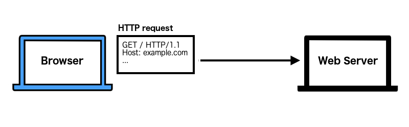
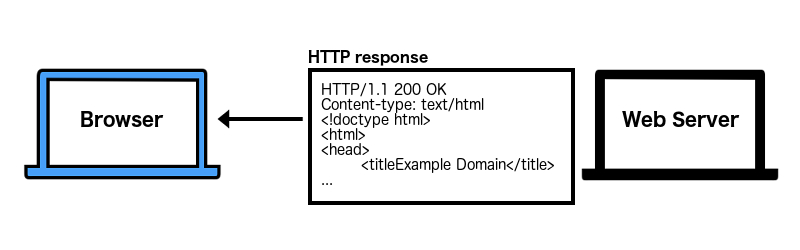
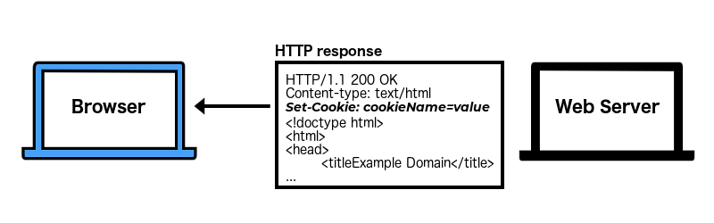
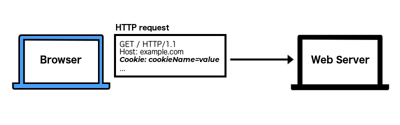



## Before cookies

When the internet was young, you would visit a web page and read it - much like you're doing now.

There was no "logging in". No shopping carts. No customized advertisements.

You requested a page. The web server delivered that page. End of transaction.

### Why? Because `HTTP` is stateless

Browsers talk to web servers (to get web pages) using the _HypterText Transfer Protocol (`HTTP`)_. `HTTP` is a set of rules for how to talk to a web server so you can view or interact with a website.

But, `HTTP` is what we call a "stateless" protocol. This means a web server does not remember you if you come back wanting to interact more with a website.

For example, let's say you want to view the home page at `example.com`.

- First, your browser will send an _HTTP request_ to the web server. This request asks the web server if you can see the `example.com` home page.

- The web server finds all the components to make up the web page then returns all of it in an _HTTP response_.

- Since `HTTP` is a stateless protocol, the `example.com` web server gets amnesia and promptly forgets ever talking to your browser. It just moves on to respond to the next browser that wants to view the website.

## After cookies

Eventually someone thought, "Wouldn't it be cool if the website could remember me?" and soon cookies were created.

Now, if the website wanted to keep track of you they could do that by setting a cookie.

For example, let's say the people who own `example.com` wanted to know how long you stay on their website.

- When you visit `example.com`, your browser sends an HTTP request to their web server.

- Their web server notices you are new, so in addition to everything from before, it also adds a `Set-Cookie` header to the HTTP response.

- Your browser remembers that cookie. When you click another link on that website, your browser sends an HTTP request and attaches that cookie.

Your browser will send that cookie with every HTTP request to the `example.com` website until you close the browser (end the session).

Cookies are one reason why you can log into a website and add items to a shopping cart. Cookies are sent back and forth between the browser and web server to "remember" who you are.

It's turned out to be a pretty handy feature.

## Why we must protect our cookies
If the cookie is how I stay logged into a website, then someone who steals my cookie can use it to log into my account.

Cookies are often used to identify you - much like a driver's license. If someone stole your license, and looked similar to you, they could pretend to be you.

If someone steals your cookies, they can also pretend to be you - or at least use that cookie to log into your account and do bad things.

This is why we must try to protect our cookies and as developers, why we must protect our user's cookies.

---

**_Next:_** Read [Part 2 - Cookie Default Behavior]()