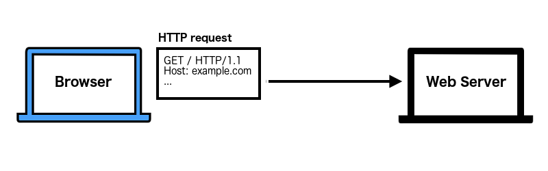
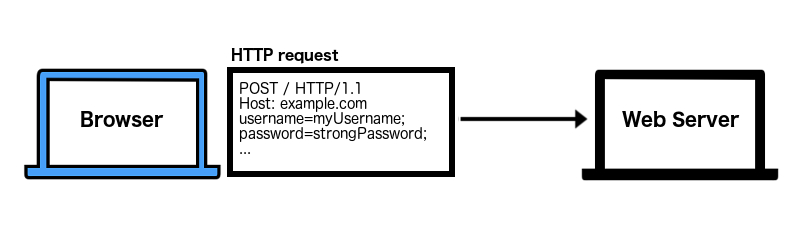
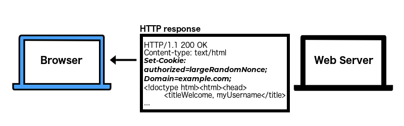
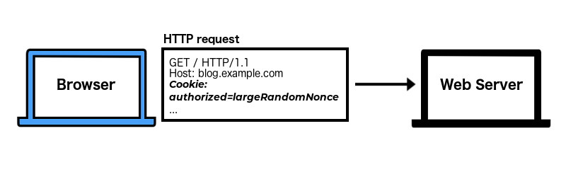
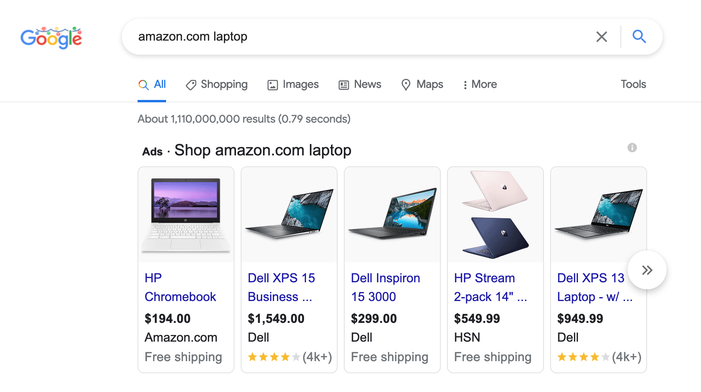



In [Part 6](), we discussed how the `Secure` and `HttpOnly` attributes work to increase the privacy of your cookies.

In this post we'll talk about how the `SameSite` attribute determines when your cookies are attached to third-party requests.

---

## `SameSite`

`SameSite` is a relatively new attribute, but is supported on all current major browsers.

But to discuss `SameSite`, first we need to clarify what the word 'site' technically means.

### What exactly is a site?

When we discuss a site, we are specifically talking about the eTLD+1 -  the _effective Top Level Domain (eTLD)_ plus the part of the domain before it (the +1).

The eTLD is the top-level domain as determined by the [Public Suffix List](https://publicsuffix.org/list/){:target="_blank"}. When we combine the eTLD with the part of the domain just before it, we get the eTLD+1/site.

For example, consider `https://www.example.com`:

- `.com` is the eTLD _(according to the [Public Suffix List](https://publicsuffix.org/list/){:target="_blank"})_
- `example` is the +1
- **`example.com`** = eTLD+1/site

We need to know exactly what the word 'site' means if we're comparing different origin requests.

For example, are these two origins the same site as `https://www.example.com`?

| Other Origin | eTLD+1/site | Same site as `example.com`? |
| --- | --- | --- |
| `https://blog.example.com` | `example.com` | Yes |
| `https://www.example.org` | `example.org` | No - different eTLD |

In the table above, `blog.example.com` is the same site because we don't have to factor in the subdomain. We only check the eTLD (`.com`) and the part of the domain just before it (`example`). This makes `https://blog.example.com` the same site as `https://www.example.com`.

The second origin, `https://www.example.org` is a different site because the eTLD is different (`.org` vs `.com`).

#### Using the Public Suffix List for eTLD

It's important to check the [Public Suffix List](https://publicsuffix.org/list/){:target="_blank"} when determining the eTLD. Some sites, such as `github.io`, host user content and the eTLD will be different than you might expect.

For example, let's determine the site of `https://someuser.github.io`:

- `github.io` is the eTLD _(seriously, check the [Public Suffix List](https://publicsuffix.org/list/){:target="_blank"})_
- `someuser` is the +1
- **`someuser.github.io`** = eTLD+1/site

So, when you're comparing `https://someuser.github.io` to `https://anotheruser.github.io`, they will be different sites.

This situation is not particularly common. Most eTLD's will behave as you expect. But it's important to check the [Public Suffix List](https://publicsuffix.org/list/){:target="_blank"} first when comparing sites.

**_Note:_** Check out [this WebDev article](https://web.dev/same-site-same-origin/){:target="_blank"} for more details about understanding the terms 'site' and 'origin'.

#### Why should you care about the site?

`SameSite` literally compares one site to another. Understanding exactly how the browser compares them is vital to knowing when cookies will or will not be shared.

Also, [_Cross-Site Request Forgery (CSRF)_ attacks](https://portswigger.net/web-security/csrf){:target="_blank"} can still happen if attackers can run code on any one of your subdomains - even if you've used the most secure `SameSite` attribute. Why? Because code running on a subdomain is generally considered the same 'site' so cookies will always be shared _(unless another attribute prevents it)_.

It's important to understand the limitations of `SameSite` and to always use defense in depth measures like [CSRF tokens](https://portswigger.net/web-security/csrf/tokens){:target="_blank"} too.

---

### Who set the cookie?

When `SameSite` is set, the browser has to determine whether to send the cookies along with the HTTP request. To do that, first the browser must determine whether this is:

- **first-party context**
	- the site that set the cookie is the site you see in the navigation bar
- **third-party context**
	- the site that set the cookie is **not** the one you see in the navigation bar

#### First-party context

First-party context is when you are on the site that set the cookie.

For example,

1. you visit `example.com`


2. you log in


3. a cookie is set for `example.com` and all its subdomains


4. you click on a post at `blog.example.com` and the cookie will be sent with this request


The cookie was set by the site you're currently on (`example.com`) so we're in first-party context.

The browser always sends cookies in first-party context no matter which `SameSite` value you set, unless another attribute prevents it.

#### Third-party context

In third-party context, the site that set the cookie is not the site you see in the navigation bar. Instead, the third-party site has included resources (like an image, link, or a frame) from the site that set the cookie.

For example:

1. you perform a search on `google.com`
2. you see an ad displayed from `amazon.com`


In this example, the image for the ad is from `amazon.com`, but it's displayed on `google.com`. This means the image, and any other resources, from `amazon.com` are in **third-party context**.

Third-party context is when `SameSite` comes into play.

Do you want cookies to be sent when your website's content is displayed on a different site? Do you want cookies to be sent when a user clicks on a link to your site (from another site)? Or do you never want cookies to be sent in a third-party context?

This is what you get to decide when setting the `SameSite` attribute.

---

### Setting `SameSite`

`SameSite` has 3 different options:

- `None` _(default setting for older browsers)_
- `Lax` _(default setting for newer browsers)_
- `Strict`

To set `SameSite` for a cookie, you add `SameSite=` then one of those options.

For example, to set `SameSite` to `Strict`, you would do something like this:

```
Set-Cookie: cookieName=cookieValue; SameSite=Strict;
```

**_Note:_** Since `SameSite` is still relatively new, it might behave differently depending on your browser. Learn more about browser behavior at [MDN Web Docs: SameSite Browser Compatibility](https://developer.mozilla.org/en-US/docs/Web/HTTP/Headers/Set-Cookie/SameSite#browser_compatibility){:target="_blank"}.

#### `SameSite=None`

If you set `SameSite=None`, you essentially turn it off and cookies will always be sent with a third-party HTTP request. This is the default behavior of most older browsers.

This is also the least secure option of the 3. It offers no privacy or protection against CSRF attacks at the browser level.

**Remember:** No matter which `SameSite` protection you're implementing, you should also add protective measures like CSRF tokens.

**_Note:_** If you want to use `SameSite=None` in newer browsers, you might also need to set the `Secure` attribute. Find out which browsers require `SameSite=None;Secure;` at [MDN Web Docs: SameSite Browser Compatibility](https://developer.mozilla.org/en-US/docs/Web/HTTP/Headers/Set-Cookie/SameSite#browser_compatibility){:target="_blank"}.

#### `SameSite=Lax`

With newer browsers, `SameSite=Lax` is the default behavior.

According to [MDN Web Docs](https://developer.mozilla.org/en-US/docs/Web/HTTP/Headers/Set-Cookie/SameSite){:target="_blank"}, when you set `SameSite=Lax`:

> Cookies are not sent on normal cross-site subrequests (for example to load images or frames into a third party site), but are sent when a user is _navigating_ to the origin site (i.e., when following a link).

So cookies will not be sent when a third-party is loading resources (such as images) from your website. But cookies will be sent when a user clicks on a link to visit your website.

`SameSite=Lax` is useful for cookies that only affect the display of your site, such as which color scheme to display for that user. It's not recommended for cookies related to actions your user might take, such as updating their password.

`Lax` also helps protect against CSRF attacks as long as you use the `POST` method whenever you want to modify data. If there is even a chance the attacker could use a `GET` method to alter data, then they could still perform a CSRF attack if you don't have additional defenses like CSRF tokens.

#### `SameSite=Strict`

Understandably, this is the strictest, and most secure, option.

If you set `SameSite=Strict`, cookies will only be sent when they are requested by the same site (first-party context). They will never be sent when requested by a third-party.

This is the recommended setting for cookies related to actions your user can perform, such as changing account details or purchasing items.

**Remember:** Subdomains are considered the same site for the majority of websites. If an attacker can run code on one of your subdomains, such as with an [XSS attack](https://owasp.org/www-community/attacks/xss/){:target="_blank"}, they could potentially steal user cookies even if all cookies have `SameSite=Strict`.

---

### Why don't we always use `Strict`?

Why not use `Strict` for all cookies? It's great from a security and privacy perspective, but would be inconvenient or unfeasible in certain situations.

For example, let's say you're logged into Amazon. The cookie that recognizes you're logged in has the attribute `SameSite=Strict`.

```
HTTP/1.1 200 OK
Content-type: text/html
Set-Cookie: loggedIn=largeRandomNonce;SameSite=Strict;
...
```

In a separate tab, you're searching Google for a new laptop. You see a laptop listed for sale on Amazon that looks interesting.


You click on the link and are directed to Amazon, but you're not logged in. Why? Because the link you clicked on came from a different site (Google). The Amazon logged in cookie was set with `SameSite=Strict`, so the browser didn't attach it to your request from Google.

_Example of the HTTP request your browser sent when you clicked the Amazon link on Google (no cookie attached):_

```
GET /aclk?sa=L&ai=DChcSEwjOqtiEl8j_AhXhe9QB... HTTP/1.1
Host: amazon.com
...
```

Once you're on Amazon, if you refresh the page or click anywhere else on their site, you will appear logged in again. Because that new request originated from Amazon (the same site as the cookie), not Google (a third-party site), so the cookie was now sent.

_Example of the HTTP request your browser sent (Amazon cookie attached):_


```
GET /aclk?sa=L&ai=DChcSEwjOqtiEl8j_AhXhe9QB... HTTP/1.1
Host: amazon.com
Cookie: loggedIn=largeRandomNonce;
...
```

#### Same scenario, but with `Lax`

Now let's imagine that same scenario, but Amazon's login cookie is set with `SameSite=Lax`.

You've logged in on Amazon on one tab.

_Example of the HTTP response the Amazon web server sent after you logged in:_

```
HTTP/1.1 200 OK
Content-type: text/html
Set-Cookie: loggedIn=largeRandomNonce;SameSite=Lax;
...
```

In another tab, you have Google open. On Google, you click on a link to Amazon. Once you're redirected to Amazon, you see you're still logged in.

_Example of the HTTP request your browser sent when you clicked the Amazon link on Google (Amazon cookie attached)_

```
GET /aclk?sa=L&ai=DChcSEwjOqtiEl8j_AhXhe9QB... HTTP/1.1
Host: amazon.com
Cookie: loggedIn=largeRandomNonce;
...
```

When the cookie is set to `SameSite=Lax`, the cookie will be sent when a user clicks on a link from a third-party site.

That's a pretty common use case where `Lax` is a better choice for user convenience.

**_Note:_** You might notice that Amazon requires you to log in again if you want to make a change your account, like updating your email address. Having different cookies that allow you to perform different actions can be a more secure option. You can then apply different security settings to each cookie and help prevent unauthorized actors from performing sensitive actions with a stolen cookie.

So, `Strict` is more secure and private, but somewhat inconvenient. That's probably why most browsers currently default to `Lax`.

But `Lax` won't stop all CSRF attacks while `Strict` will. Neither is foolproof though and you should always employ defense in depth to protect your application.

---

### Pick one and set it

Which setting should you use? Honestly, I can't answer that for you since every situation is unique.

No matter which setting you choose, it's important to set the `SameSite` attribute and use the most secure option you can - even if it's just `SameSite=None;Secure`. This lets other developers know when that cookie will be shared and that it probably shouldn't be used for sensitive actions.